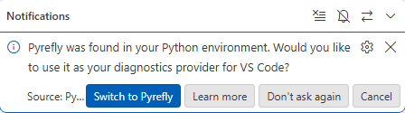
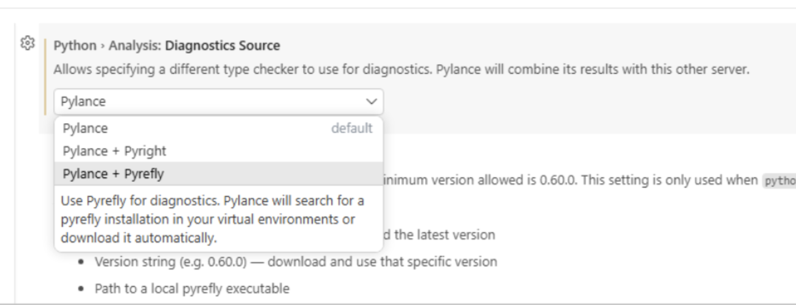
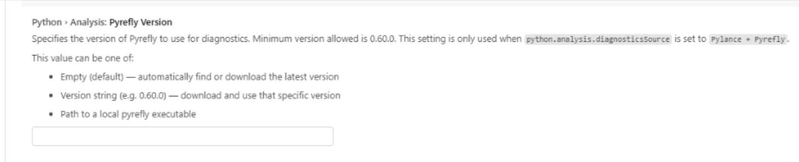
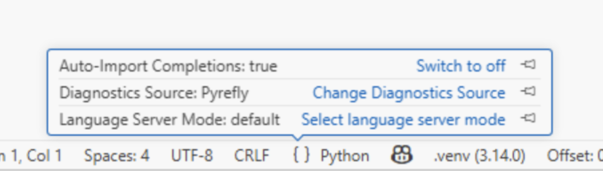

If you use Pylance in VS Code for its completions, navigation, or GitHub Copilot integration, you can now use Pyrefly as its type checking backend. We have been working with the Microsoft Python team to make this possible. The result is a new diagnostics source option in Pylance that uses Pyrefly instead of Pyright to power the type analysis backend, keeping the Pylance experience intact.

<!-- truncate -->

## Why this matters

Until now, Pylance has been tightly coupled to Pyright, and if you wanted Pylance's features, you got Pyright's type checking whether it matched your project or not. If you preferred Pyrefly for its performance, its inference behaviour, or its support for patterns like Pydantic and Django, you had to give up the Pylance ecosystem entirely and install the standalone [Pyrefly VS Code extension](https://marketplace.visualstudio.com/items?itemName=meta.pyrefly).

That trade-off is now gone. You can choose the type checker that fits your codebase and your team, without losing the Pylance features you depend on (like tight integration with GitHub Copilot).

## How it works

Under the hood, this integration uses a new open protocol called the [Type Server Protocol (TSP)](https://github.com/microsoft/pylance-release/blob/main/docs/tsp/type-server-protocol.md), which defines a standard interface between an editor intelligence layer and a type checker. We worked together with the team at Microsoft to design and implement TSP and to ensure that Pyrefly fully supports it.

You can read more about the collaboration with Microsoft on their blog [here](https://devblogs.microsoft.com/python/announcing-tsp/).

## Should you use the Pyrefly extension or the Pyrefly + Pylance integration?

We still recommend the standalone [Pyrefly VS Code extension](https://marketplace.visualstudio.com/items?itemName=meta.pyrefly) for most users. It gives you the most direct Pyrefly experience with the least overhead: diagnostics, completions, go-to-definition, hover, and refactoring actions, all powered by Pyrefly's language server with no intermediary.

The Pylance integration is the better choice if:

* You rely on GitHub Copilot's integration with Pylance
* Your team has standardised on Pylance and you want to introduce Pyrefly without changing everyone's extension setup
* You want Pylance-specific features (its smart completion ranking, Quick Info, or environment management) alongside Pyrefly's type analysis

## Try it

TSP support with Pyrefly is available to all VS Code users now. The following sections describe how the experience works.

### Automatic detection

When you open a workspace, Pylance checks your Python environments for a Pyrefly installation. If it finds one, whether installed in your virtual environment or indicated by a `pyrefly.toml` or `[tool.pyrefly]` configuration in your project, you will see a notification:

*Pyrefly was found in your Python environment. Would you like to use it as your source of diagnostics in Visual Studio Code?*

Click **Switch to Pyrefly** and Pylance will activate Pyrefly as your diagnostics source immediately, registering the path to the Pyrefly executable automatically. No manual configuration needed. If you'd prefer to decide later, **Cancel** dismisses the notification for the session. Click **Don't ask again** to suppress it permanently. You can re-enable detection at any time in settings.

### Manual setup via settings

You can also switch at any time through the Visual Studio Code Settings UI. You can paste `vscode://settings/python.analysis.enableExternalTypeServer` into any browser to open up the appropriate setting.

Under **Python > Analysis: Diagnostics Source**, you will find a dropdown with three options:

* **Pylance** (Default): uses Pylance's built-in analysis.
* **Pylance + Pyright**: explicitly routes diagnostics through Pyright.
* **Pylance + Pyrefly**: uses Pyrefly as the diagnostics engine.

When **Pylance + Pyrefly** is selected, Pylance will locate a Pyrefly installation in your virtual environments or download it automatically.

A companion **Python > Analysis: Pyrefly Version** setting allows you to pin a specific version, point to a local executable, or leave the value empty to always use the latest release. The minimum supported version is 0.60.0.

### Status bar

Once active, the status bar shows **Diagnostics Source: Pyrefly** alongside your interpreter and environment. Selecting it opens a quick menu where you can switch sources or change settings without leaving your file.

## What's next and how to get involved

We're excited to see more VSCode users get access to the performance enhancements that Pyrefly can bring and we'll be continuing to work with the Microsoft Python team to make your IDE experience even better. If you have feedback on the integration we'd love to hear from you!

* [Join the Pyrefly Discord](https://discord.gg/Cf7mFQtW7W)
* [Open an issue in Pylance](https://github.com/microsoft/pylance-release)
